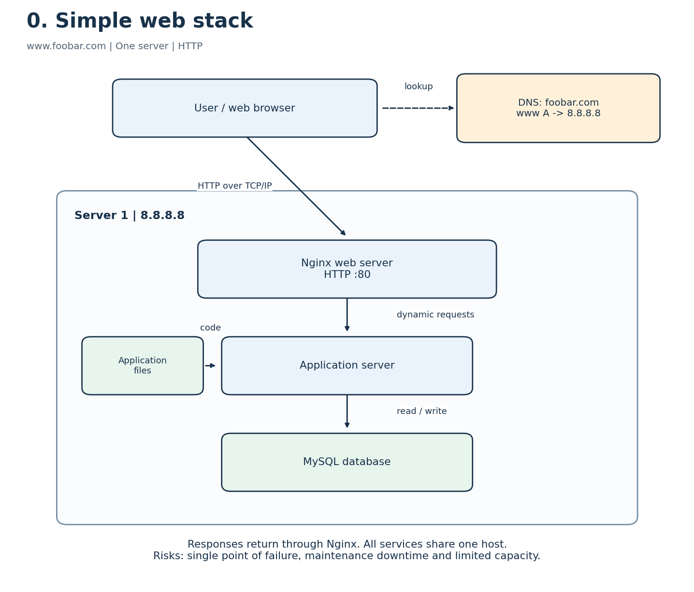

# Simple web stack

## A user requests the website

1. A user enters `http://www.foobar.com` in a browser.
2. The browser uses a DNS resolver to look up `www.foobar.com`. In this design, the `www` **A record** in the `foobar.com` zone contains `8.8.8.8`.
3. The browser opens a TCP connection to the server on port 80 and sends an HTTP request. DNS resolves the name; website traffic then goes directly to the server, not through DNS.
4. Nginx serves static files such as images and CSS. For a dynamic page, it forwards the request to the application server on a private, local port.
5. The application server runs the application code. It queries MySQL when it needs stored data and builds the response.
6. The response returns through Nginx to the browser, which displays the page.

The address `8.8.8.8` is used as the server IP only for this exercise. It is Google's public DNS resolver in reality; this is a diagram, not a deployment to that address.

## Components

| Component | Role |
| --- | --- |
| Server | A physical computer or virtual machine that provides resources or services to clients. Here, one host runs all four components. |
| Domain name | A human-readable name that DNS maps to an address, so users do not have to remember the IP. |
| `www` DNS record | An A record mapping `www.foobar.com` directly to the IPv4 address `8.8.8.8`. It is not a CNAME in this design. |
| Nginx web server | Accepts HTTP requests, serves static content and proxies dynamic requests to the application server. |
| Application server | Executes application logic, handles input and creates dynamic responses. |
| Application files | The code, templates and static assets used by the application and web server. |
| MySQL database | Persists structured application data and handles reads and writes. |

The server communicates with the user's computer using **HTTP over TCP/IP** in this first design. HTTP defines the web messages, TCP provides reliable ordered transport, and IP addresses and routes packets. The application and database use local connections inside the host.

## Limitations

- **Single point of failure (SPOF):** if this host fails, the whole website fails. Nginx, the application process and the database are also single instances whose failure can interrupt their respective functions.
- **Maintenance downtime:** a reboot or a deployment requiring an application restart can interrupt service because no second host can take traffic. A graceful Nginx reload can avoid some interruptions, but it does not remove the single-host risk.
- **Limited scaling:** all components share CPU, memory, disk and network capacity. More traffic can exhaust the host; adding resources to one machine has limits and there is no second application host to share the load.
