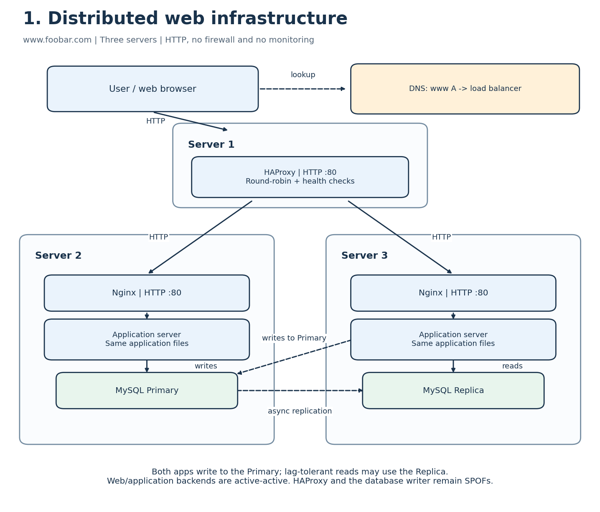

# Distributed web infrastructure

## Layout and request flow

There are exactly **three infrastructure servers**:

- **Server 1:** HAProxy load balancer, reached through the `www.foobar.com` A record.
- **Server 2:** Nginx, an application server, the application files and the MySQL Primary.
- **Server 3:** Nginx, an application server, the same application files and the MySQL Replica.

A user opens `http://www.foobar.com`. DNS returns the load balancer address. HAProxy forwards the request to a healthy Nginx instance. Nginx serves static content or forwards a dynamic request to its local application server. Both application instances send writes to the Primary. Reads that tolerate replication lag may go to the Replica; reads requiring up-to-date data go to the Primary. The response returns along the reverse route.

## Why add these components?

| Addition | Reason |
| --- | --- |
| HAProxy | Provides one entry point, distributes requests and removes unhealthy web backends from its rotation. |
| Second Nginx and application server | Shares request processing and lets one web/application instance continue serving when the other is unavailable. |
| Second copy of application files | Lets either application instance run the same version of the site. Deployments should keep the copies consistent. |
| MySQL Replica | Provides a replicated data copy and can serve suitable reads to reduce read load on the Primary. Replication is not a replacement for backups. |

## Distribution algorithm and operating mode

HAProxy is explicitly configured with **round-robin**, equal backend weights and health checks. Successive new requests are assigned to the healthy backends in rotation: Server 2, Server 3, then Server 2 again. An unhealthy backend is skipped. This distributes requests, but does not guarantee equal CPU usage because requests can require different amounts of work.

The **web/application tier is active-active**: both backends receive traffic at the same time. An active-passive backend setup would keep one backend on standby until the active backend fails. There is only one load balancer here; the load-balancer tier itself is not a redundant cluster. Application sessions should not depend on memory held by only one backend; for example, use signed session cookies or an appropriate shared session store.

## Primary-Replica replication

The Primary accepts application writes and records changes in its binary log. The Replica receives these events and applies them to its own data. In this design replication is asynchronous, so a committed write can reach the Replica later. Configure the Replica as read-only for application accounts.

The application must distinguish the two roles: **writes and consistency-sensitive reads go to the Primary; lag-tolerant reads can go to the Replica**. A write to one application's local database is not automatically safe just because each server has a database. The application instances must use the correct database endpoint.

If the Primary fails, the Replica does not automatically become writable in this design. Promotion, checking replication progress, preventing writes to the old Primary and updating the application endpoint require a failover procedure. Unreplicated recent writes may be lost during asynchronous failover.

## Limitations

- **SPOFs:** the single HAProxy host is the only public entry point. The Primary is the only database accepting writes; losing Server 2 therefore also interrupts writes from Server 3. No redundant public network path is shown.
- **Security:** there is no firewall policy or HTTPS in this task. HTTP traffic can be observed or modified, and unnecessary exposed services increase the attack surface.
- **No monitoring:** there are no collectors, dashboards or alerts to reveal errors, replication lag or resource exhaustion. HAProxy backend health checks alone are not full monitoring.
- **Shared resources:** each backend combines web, application and database workloads, so one workload can interfere with the others.

## References

- [HAProxy backends and algorithms](https://www.haproxy.com/documentation/haproxy-configuration-tutorials/proxying-essentials/configuration-basics/backends/)
- [MySQL replication](https://dev.mysql.com/doc/mysql-replication-excerpt/8.0/en/replication.html)
