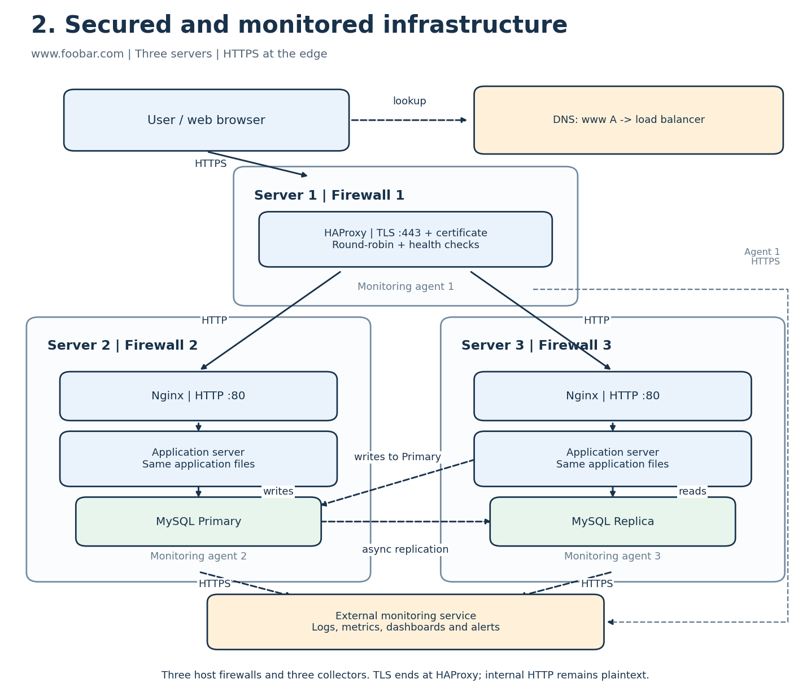

# Secured and monitored web infrastructure

## Layout and request flow

The design keeps the three servers from the distributed infrastructure. Each host now has **one host firewall and one monitoring agent**: three firewalls and three agents in total. HAProxy holds a valid TLS certificate covering **www.foobar.com**. The external monitoring service is a managed destination, not a fourth website server.

A user visits `https://www.foobar.com`. DNS returns the load balancer address. The browser establishes TLS on port 443 and checks the certificate chain and hostname. HAProxy terminates TLS, then forwards HTTP to a healthy backend. Nginx forwards dynamic requests to its local application server. Both applications write to the Primary and may read from the Replica when stale reads are acceptable. Database replication remains asynchronous.

## Additional components

| Addition | Purpose |
| --- | --- |
| Firewall on Server 1 | Allows public HTTPS to HAProxy and restricts administrative access. |
| Firewall on Server 2 | Accepts web traffic from HAProxy and only the required private database connections. |
| Firewall on Server 3 | Applies the corresponding restrictions to the second backend and database Replica. |
| TLS certificate on HAProxy | Authenticates the website hostname and supports encryption of browser-to-HAProxy traffic. Keep the private key secret and renew the certificate before expiry. |
| Monitoring agent on each host | Collects host metrics, service metrics and logs, and sends them over HTTPS to a monitoring service such as Sumo Logic. |

## Firewall policy

A firewall permits or blocks traffic according to rules such as source, destination, protocol and port. Use default-deny inbound policies, permit established return traffic, and allow only what each host needs:

- **Load balancer:** allow inbound TCP 443 from users. If HTTP-to-HTTPS redirection is required, allow TCP 80 only for that redirect. Permit SSH only from an approved administration address.
- **Backend hosts:** allow TCP 80 from the load balancer's private address. Keep application-server ports local to their own host. Allow MySQL TCP 3306 only from the application hosts and the replication peer as needed; never publish it to the Internet. Restrict SSH to the administration address.
- **Outbound:** allow approved DNS, time synchronization, required service connections and HTTPS to the monitoring service. The Replica connects to the Primary for its replication stream.

A firewall reduces exposure; it does not repair application vulnerabilities or replace authentication and least-privilege database accounts.

## Why HTTPS?

HTTPS is HTTP protected by TLS. It encrypts data in transit, provides integrity checks and authenticates the server through its certificate. This protects credentials and page contents against network interception and modification on the browser-to-load-balancer connection.

## Monitoring and data collection

Monitoring helps detect outages, investigate errors, understand capacity and identify performance regressions. Collect CPU, memory, disk usage, request rates, latency, HTTP errors, backend health, database connectivity and replication lag. Configure alerts for sustained failures or abnormal values.

Each installed agent reads relevant logs and polls protected service metric endpoints on its host, adds timestamps and host labels, buffers data if necessary, then sends it to the monitoring service. The service stores the data, produces dashboards and evaluates alert rules. Avoid recording passwords or tokens in logs.

## Monitor web-server QPS

Here, QPS means HTTP requests per second, not database queries per second.

1. Enable Nginx `stub_status` on a local-only or otherwise restricted endpoint, such as `/nginx_status`.
2. Have each backend's agent sample the cumulative **requests** counter at a fixed interval.
3. Calculate `QPS = (requests_now - requests_previous) / elapsed_seconds`.
4. Handle counter resets after a restart; do not report negative QPS. Display per-host rates and sum the two backend rates for the backend tier. Do not add HAProxy's count to this sum, which would count the same requests twice.
5. Alert on unusual sustained rates alongside latency, error rate and resource usage. Active connections are not the same measurement as QPS. Health checks and monitoring requests may need separate accounting.

## Remaining issues

- **TLS termination at HAProxy:** the browser connection is encrypted, but this design forwards plaintext HTTP internally. Anyone able to observe or alter that internal path could access traffic. Re-encrypt HAProxy-to-Nginx connections and verify backend certificates to protect that path. Database connections also need separate transport encryption where required.
- **Only one writer:** the Primary is still a write bottleneck and a SPOF for writes. A Replica needs a controlled promotion process; monitoring does not automatically provide database failover.
- **Identical mixed-component hosts:** web, application and database services compete for resources, cannot scale independently and share a maintenance and failure boundary. A compromised web host is also a database host.
- **Single load balancer:** firewalls, TLS and monitoring do not make the lone HAProxy host redundant.

## References

- [Nginx stub_status counters](https://nginx.org/en/docs/http/ngx_http_stub_status_module.html)
- [MySQL replication](https://dev.mysql.com/doc/mysql-replication-excerpt/8.0/en/replication.html)
