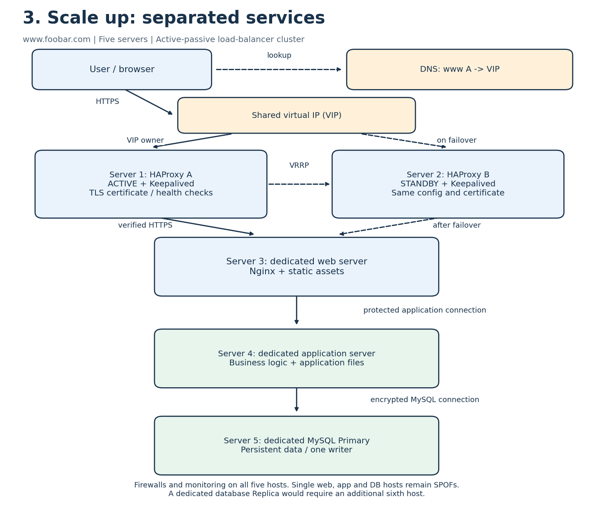

# Scale up

## Target layout

This design uses **five servers**: two HAProxy hosts, one dedicated Nginx host, one dedicated application host and one dedicated MySQL host. Compared with the previous three-host layout, add one HAProxy host and one further server, then redistribute the components across the five hosts.

| Server | Component | Why it is used |
| --- | --- | --- |
| 1 | HAProxy A and Keepalived, normally active | Provides the normal public entry point through a shared virtual IP. |
| 2 | HAProxy B and Keepalived, normally standby | Takes ownership of the virtual IP if the active load balancer fails. |
| 3 | Nginx web server and static assets | Handles HTTP delivery and reverse proxying independently of application and database workloads. |
| 4 | Application server and application code | Runs business logic on resources that can be tuned independently of Nginx and MySQL. |
| 5 | MySQL Primary | Keeps persistent data on a dedicated host with its own memory, storage and backup requirements. |

This minimum five-host layout has **one dedicated database host**, so it does not retain the previous Replica as a separate server. Retaining a separately hosted Replica would require a sixth host. This tradeoff is explicit: load-balancer redundancy does not imply database redundancy.

## Load-balancer cluster

Use an **active-passive HAProxy pair**, coordinated by Keepalived/VRRP with a shared virtual IP on a network that supports VIP failover. The `www.foobar.com` A record points to the VIP, not to either host's fixed address.

Keepalived health tracking checks the local HAProxy process and coordinates which host owns the VIP. If the active host fails, the standby takes ownership and advertises the change. Keep HAProxy configuration and certificate material consistent on both hosts. Failover is not necessarily seamless: existing connections can be lost and clients may need to reconnect. The VRRP/VIP mechanism and underlying network must be configured to avoid conflicting ownership.

Both HAProxy instances have the same backend pool and health checks. Round-robin can distribute requests if additional dedicated web hosts are added later; with only one web host, there is no web-tier load distribution yet. HAProxy alone does not supply VIP election or stateful connection migration.

## Request flow and separation

1. The user's browser resolves `www.foobar.com` to the VIP and sends an HTTPS request to the active HAProxy instance.
2. HAProxy terminates the public TLS connection and opens a separately encrypted, certificate-verified HTTPS connection to the dedicated Nginx host.
3. Nginx serves static assets locally or proxies a dynamic request over a protected private connection to the dedicated application host.
4. The application runs its code and queries the dedicated MySQL host over a restricted, encrypted database connection.
5. The response follows the reverse path to the browser.

The **web server** handles HTTP, static assets and proxying. The **application server** runs business logic and produces dynamic content. Their code/assets are deployed to the appropriate dedicated host; MySQL data stays on the database host.

Maintain host firewalls and monitoring on all five servers. Allow each tier to reach only the required next-tier ports, restrict management access and send monitoring data to the external monitoring service. Use appropriate certificates for the additional encrypted connections; the public certificate alone does not encrypt every internal connection.

## Benefits and remaining limits

Separating components reduces resource contention, narrows the effect of service restarts and allows different sizing, maintenance and security policies per tier. The second load balancer removes the single HAProxy-host failure point, provided VIP failover and the network work correctly.

There is still only one Nginx host, one application host and one database host: each remains a SPOF for its tier. One writer also limits database write capacity. This design separates responsibilities; it is not a claim of complete high availability or horizontal scaling at every tier. Further scaling would add web/application replicas and a database Replica with tested failover and backups.

## References

- [HAProxy active/standby clustering and virtual IP](https://www.haproxy.com/documentation/haproxy-enterprise/administration/high-availability/active-standby/)
- [HAProxy backends](https://www.haproxy.com/documentation/haproxy-configuration-tutorials/proxying-essentials/configuration-basics/backends/)
